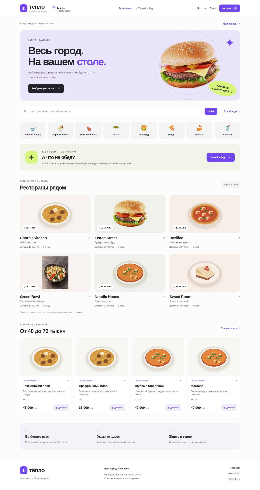

# Тёпло — веб-сервис доставки еды

Пользовательский MVP для ресторанов Ташкента. Django, HTML/CSS/JavaScript и локальная SQLite. Команда: **Саидов Шохжахон · Самиев Аюбхон**.



## Запуск на компьютере

Установите Python 3.12+, откройте терминал в папке проекта:

```bash
python start.py
```

Скрипт создаёт `.venv`, устанавливает зависимости, собирает переводы, применяет миграции и добавляет 6 демонстрационных ресторанов с 61 блюдом в 12 категориях. Повторный запуск сохраняет данные. Откройте **http://127.0.0.1:8000/**. Для остановки: Ctrl+C. Первому запуску нужен интернет для загрузки Python-пакетов.

На Windows можно использовать `py start.py`. Другой порт: `python start.py --port 8001`. Только подготовка: `python start.py --setup-only`.

**Данные сохраняются на вашем компьютере:** `db.sqlite3` — аккаунты, рестораны, меню, корзины и заказы; `media/` — загруженные изображения. Эти данные и пароли не публикуются в GitHub. Для переноса/резервной копии остановите сервер и скопируйте оба пути.

## Что работает

- Каталог ресторанов, поиск по ресторану, кухне и блюдам, отдельное меню ресторана.
- **Умный обед V2:** на странице «Умный обед» нажмите «Попробовать Умный обед V2». Укажите общий бюджет с доставкой, число человек, диету, исключения и, при желании, максимальное время доставки. Сервис покажет до шести наборов по одному ресторану в каждом. Цена включает все порции и доставку. При отсутствии наборов в бюджете V2 показывает ближайший вариант и сумму доплаты, если остальные условия выполнены.
- URL `/smart-lunch/?min_price=40000&max_price=70000` открывает фильтр отдельных блюд. Обе границы цены включаются.
- Первые, вторые, горячие блюда, фастфуд, пицца, салаты, десерты и напитки.
- Регистрация, вход, профиль, адрес, корзина, количество, оформление, история и отмена заказа до приготовления.
- Одна корзина — один ресторан. При смене требуется явное согласие; сервер повторно проверяет ресторан, доступность и цены.
- Наличные при получении; доставка 10 000 сум, бесплатно от 100 000 сум. Повторное подтверждение не дублирует заказ.
- Переключатель RU / UZ / EN: навигация, каталог, фильтры и основные элементы оформления. Названия демонстрационных блюд переведены; свободные описания ресторанов, состав и пользовательские комментарии сохраняются на языке ввода. Полная редактура текстов остаётся в плане приёмки.
- Адаптивная веб-страница, работа основных форм без JavaScript, CSRF и ограничение доступа к своим заказам.

Рестораны и меню демонстрационные. Интервалы времени приблизительные. Фактический статус меняет сотрудник, он не обновляется фиктивным таймером. Реальная онлайн-оплата и подключение партнёров не входят в этот пользовательский MVP.

## Управление

Создать администратора (самостоятельно задайте логин и пароль):

```bash
# Linux / macOS
.venv/bin/python manage.py createsuperuser
# Windows
.venv\Scripts\python manage.py createsuperuser
```

В `/admin/` доступны рестораны, категории, блюда и пользователи. Ранее реализованные веб-панели `/operations/`, `/kitchen/`, `/couriers/` сохранены для обработки заказов. Это внутренняя общая команда; изолированные кабинеты отдельных партнёров пока не реализованы.

Для автоматического предложения доставок одобренным курьерам отдельно запустите `python manage.py dispatch_orders` в активированном окружении. В настройках каждого ресторана нужны реальные адрес/координаты, у курьера — активная смена и свежая геопозиция. Демонстрационные координаты не подтверждают реальную зону доставки.

## Разработка и проверка

```bash
python -m venv .venv
# активируйте .venv для вашей ОС
pip install -r requirements-dev.txt
python scripts/compile_translations.py
python manage.py migrate
python manage.py seed_marketplace
python manage.py test
ruff check apps project
python manage.py makemigrations --check --dry-run
```

Каталог переводов: `locale/translations.json`. После изменения запустите `scripts/compile_translations.py` и перезапустите сервер. SQLite подходит для локального MVP. Нагрузочная эксплуатация требует отдельной проверки базы и инфраструктуры; имеющиеся проверки гонок для PostgreSQL сохраняются в CI.

## Документация

- [ТЗ и границы MVP](docs/marketplace-v2/01_SPECIFICATION.md)
- [Минимальный план](docs/marketplace-v2/03_ROADMAP.md)
- [46 задач до 5 декабря 2026](docs/marketplace-v2/08_PROJECT_CHECKLIST.md)
- [Чеклист Excel](docs/marketplace-v2/planning/TEPLO_TASKS_TO_05_DEC_2026.xlsx)
- [Задания 5–7](docs/marketplace-v2/README.md), [задания 8–9](docs/marketplace-v2/09_ASSIGNMENTS_8_9.md)
- [Размещение веб-сервиса](docs/DEPLOYMENT.md)
- [Протокол проверки MVP](docs/marketplace-v2/10_MVP_VALIDATION.md)

Изменение направления от 15.11.2026: все актуальные планы заменены веб-версией. История предыдущих вариантов остаётся в истории Git. Исходная презентация в `docs/presentation/` относится к первоначальной версии одной кухни и не описывает текущий каталог ресторанов.
## Обновление веб-версии

Откройте [технический паспорт](docs/marketplace-v2/10_TECHNICAL_PASSPORT.md) для запуска сайта, настройки доставки и тестовой оплаты Payme. [Презентация](docs/marketplace-v2/11_PRESENTATION.html) открывается в браузере из локальной копии проекта.
