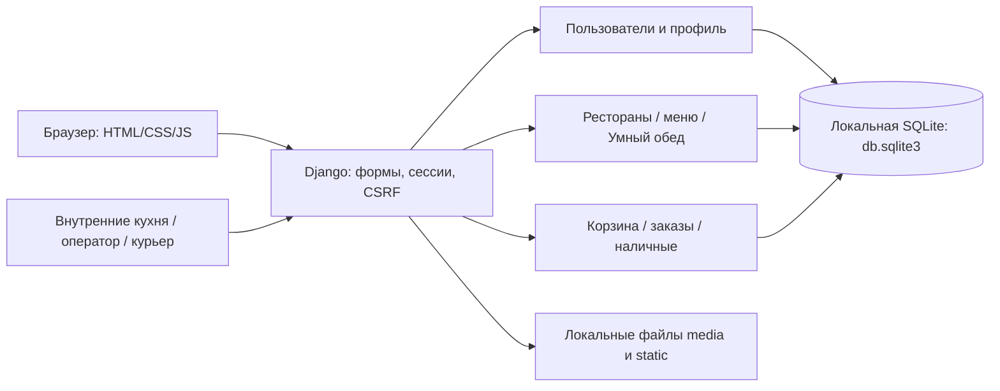

# Архитектура веб-MVP

Это модули одного Django-проекта. Для пользовательского MVP отдельные процессы каталогов, платёжные шлюзы и брокер не требуются. Веб-панели обработки и отдельный диспетчер доставок сохранены из прежней реализации.

Restaurant содержит настройки каждой кухни; MenuItem и Order ссылаются на ресторан. Миграция связывает прежние блюда/заказы с первоначальной кухней, без удаления истории. Null-связь оставлена только для совместимости с прежними фикстурами и интеграциями; административная форма требует ресторан.

Заказ в транзакции блокирует корзину, проверяет ресторан/цены/доступность, сохраняет снимок позиций и очищает корзину. checkout_token уникален. Файл SQLite не попадает в Git. Изменения структуры через миграции; не удалять db.sqlite3 для обновления.

Сессии Django, CSRF, проверка владельца заказа и роль на сервере. Для размещения нужен HTTPS. Внутренняя команда сейчас общая для всех ресторанов; роли независимых партнёров необходимо спроектировать отдельно.

Позднее при подтверждённой нагрузке можно выделить каталог, заказы, платежи, доставку и уведомления в самостоятельные сервисы. Это не зависимость текущего запуска.
