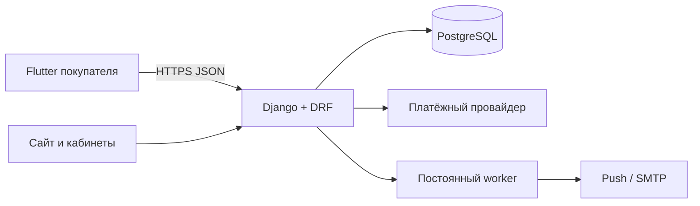

# Архитектура: первый релиз и последующее выделение сервисов

**Статус:** план восстановлен по переписке 15.11.2026. Новые функции не считаются реализованными. Дедлайны исходные; фактическое выполнение требует подтверждения команды.

## Минимальный рабочий вариант к 05.12.2026

Переиспользуем текущую бизнес-логику; добавляем многоресторанную модель и API. Не создаём пять пустых приложений вместо готового заказа. Внутри одного Django разделяем модули и доступы; операции одной БД используют локальные транзакции. Намерения фоновых действий сохраняются до commit, повтор исполняется идемпотентно. Redis/очередь подключаются по необходимости, не являются единственной копией заказа или денег.

## Будущие границы микросервисов

| Модуль / сервис | Владелец данных |
|---|---|
| Identity | Аккаунты, сессии, восстановление, блокировки |
| Catalog / Partners | Рестораны, филиалы, membership, меню, цены, зоны, графики, quote, Умный обед |
| Orders | Корзина, снимки заказа, исполнение, решения кухни, обращения, orchestration |
| Delivery | Курьеры, смены, GPS, предложения и назначения |
| Payments | Попытки, подтверждённые операции, возвраты, свидетельства наличных и сверка |

При выделении — отдельные контейнеры, роли и базы, никаких чужих ORM/SQL JOIN. Единый BFF/gateway для публичного API; HTTP для команд/актуальных проверок, broker/outbox/inbox для событий. Сообщения имеют event ID, aggregate ID/version, schema version, correlation ID; повтор безопасен, пропущенная версия сверяется со снимком. Распределённая transaction.atomic невозможна: Orders хранит шаги и компенсации.

## Первые модели и контракты

`Restaurant`, `Branch`, `RestaurantMembership`, `MenuItem(branch_id)`, `Cart(branch_id)`, `Order` со снимками, `PaymentAttempt`, `Refund`, `Courier`, `Assignment`. Межсервисные ID в будущем устойчивые, не общие ORM-модели. Архивные заказы не зависят от будущего удаления меню.

API `/api/v1`: auth/register/login/refresh/logout; profile/addresses; restaurants/branches/menu; quotes; smart-lunch/recommendations; cart; orders и допустимые действия; partner/kitchen queue; courier shift/location/offers/pickup/complete; payment start/status и callback выбранного протокола. До кода фиксируются права, примеры JSON, версии и ошибки в OpenAPI.

## Авторизация и мобильный клиент

Web — HttpOnly/Secure/SameSite cookie + CSRF. Flutter — короткий access и ротируемый refresh в Keystore-backed secure storage, отзыв устройства, без секретов в APK. Сервер проверяет actor и объект на каждом endpoint. Внутренние сервисные токены не выдаются мобильному клиенту. Возврат из провайдера открывает свой заказ и запрашивает серверный статус.

Языки: Flutter ARB/gen-l10n и Django gettext; машинные коды ошибок стабильны. UZS и UTC timestamp не переводятся. UI и шаблоны push имеют uz/ru/en, пользовательский текст не переводится автоматически. FCM worker не является шестым бизнес-сервисом, payload содержит минимум данных; потеря push не меняет заказ.

## Гонки и деньги

Orders владеет состоянием заказа. Отмена и забор сериализуются одной проверкой/блокировкой. Delivery не объявляет заказ доставленным самостоятельно. Ключи оформления/денежных команд стабильны; подтверждения провайдера проверяются по сумме, валюте и transaction ID. Два разных успешных списания оба учитываются, лишнее возвращается/эскалируется. Отменённый заказ не оживает после позднего успеха. Сбой возврата виден оператору.

При будущем разделении команда pickup имеет assignment ID/version; Delivery сохраняет намерение, Orders меняет допустимый этап и публикует результат. Timeout выясняется по ключу; назначение не меняют, пока исход pickup неизвестен. Для наличных свидетельство вручения и событие сохраняются атомарно Orders, ledger Payments может обновиться позже.

## Переход с текущего проекта

Сейчас кухня закреплена `pk=1`, меню/корзина не разделены по филиалам, а Django-модели тесно связаны. Сначала копия БД/media; затем новые модели и backfill старой кухни в первый филиал. Проверить количества и суммы, включить ограничения, запретить чужие объекты. Удаление старых полей — после окна отката. Затем извлекать сервисы по одному, каждый с одним источником записи; двойная запись без согласования запрещена.

Независимые сервисы, Kubernetes, ML-кластер и масштаб 1000–2000 пользователей не входят в ограниченный календарный релиз. Историческая оценка 16–22 недели относится к расширенной версии; актуальные задачи — [чеклист](08_PROJECT_CHECKLIST.md).
