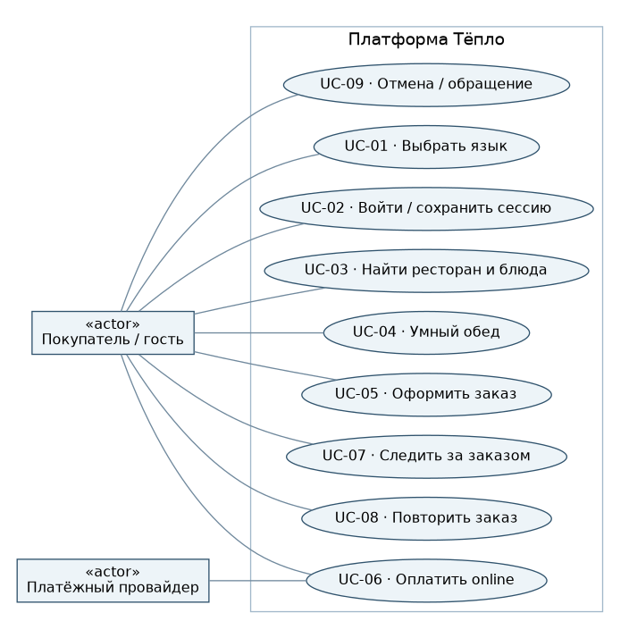
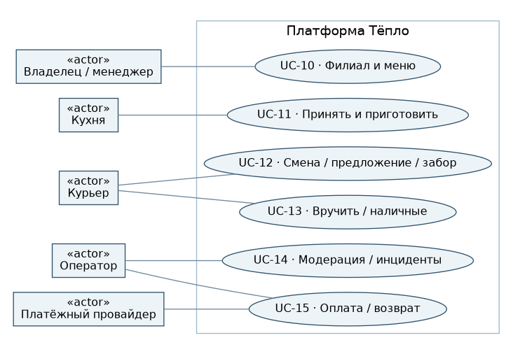

# Задание 7. Варианты использования

**Статус:** план восстановлен по переписке 15.11.2026. Новые функции не считаются реализованными. Дедлайны исходные; фактическое выполнение требует подтверждения команды.

Команда: Саидов Шохжахон, Самиев Аюбхон. Акторы — внешние участники, овалы — их цели, рамка — платформа; линии участия не изображают HTTP-поток. Гостю доступны язык/каталог/подбор, оформление требует входа.

## Покупатель

[DOT](diagrams/customer-use-cases.dot) · [SVG](diagrams/customer-use-cases.svg).

UC-01 язык; UC-02 сессия; UC-03 меню; UC-04 подбор; UC-05 оформление; UC-06 online; UC-07 статус; UC-08 повтор по актуальным ценам; UC-09 отмена/помощь. Соответствуют MB-01–06, FR-01–02/06–15/22/25/27–32, SM-01–08.

## Партнёры и исполнение

[DOT](diagrams/operations-use-cases.dot) · [SVG](diagrams/operations-use-cases.svg).

UC-10 владелец/менеджер меняет только своё; UC-11 кухня принимает/готовит; UC-12 одобренный курьер принимает своё предложение; UC-13 вручает и подтверждает наличные; UC-14 оператор решает инциденты с аудитом; UC-15 провайдер сообщает факты оплаты/возврата. Соответствуют FR-03–05/08/13–14/16–32. Внутренние микросервисы не являются внешними акторами этой диаграммы.

## Детальные сценарии

**Оформление:** активная сессия и непустая корзина одного филиала → проверка прав/ключа/quote → снимок заказа → наличные сразу к ресторану, online сначала провайдер → подтверждённый сервером успех → ожидание ресторана. Новая цена требует согласия; timeout проверяется по ключу; поздняя оплата отменённого заказа требует возврата. Итог — один заказ и честное денежное состояние.

**Умный обед:** район/язык/бюджет/предпочтения → доступные блюда одного филиала → состав/доставка/итог/объяснение → согласованный перенос → обычное оформление. Пустой подбор объясняется; неизвестный состав исключается строгим фильтром; новая цена пересчитывается. Язык не меняет сумму.
