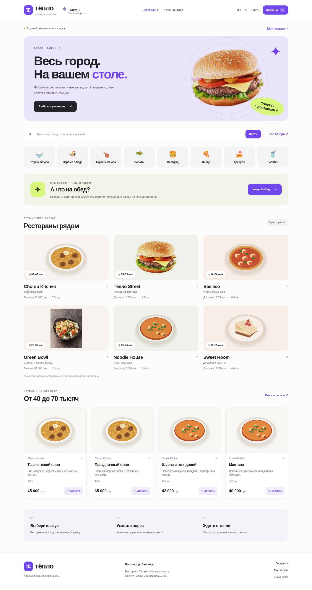
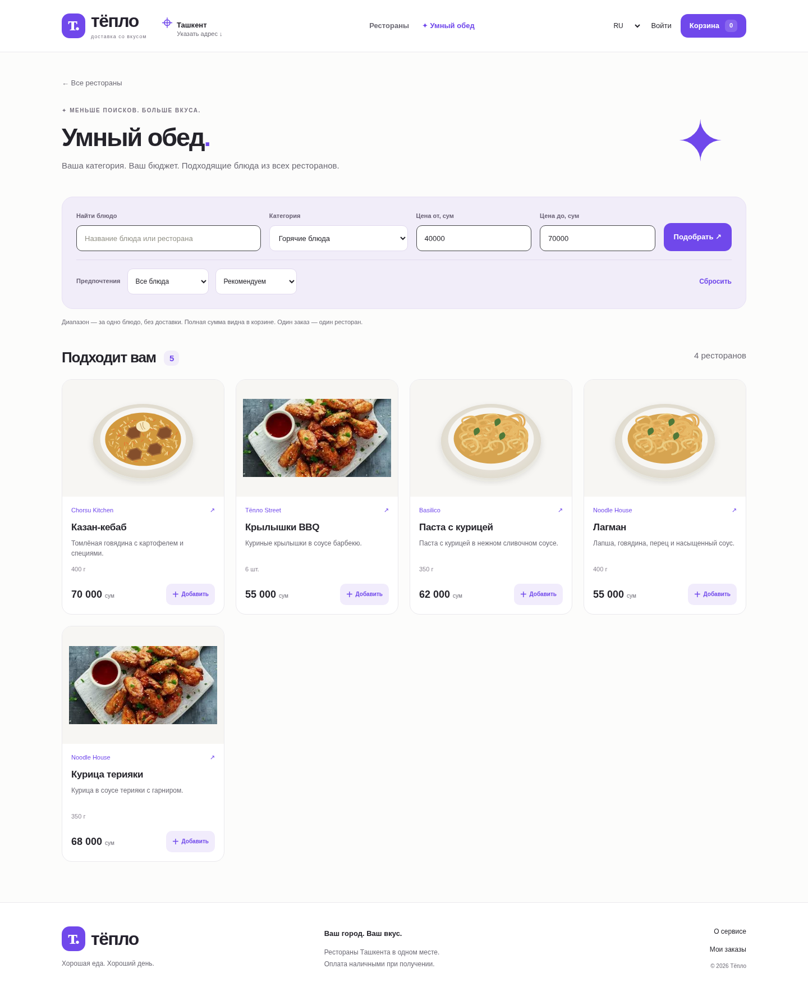

# Задания 8–9. Программа и GitHub

## Задание 8

Программа: пользовательский веб-MVP «Тёпло». Запуск: python start.py. Скриншоты сделаны в настоящем браузере на локальном Django с демонстрационными данными.

## Задание 9

Исходные программные файлы размещаются в репозитории студента: https://github.com/Shohjahon2707/Fast-Food-delivery . Для сдачи снимите открытый репозиторий после обновления: должны быть видны владелец, название и список программных файлов. Снимок предыдущей версии удалён из актуального пакета, чтобы не выдавать его за новый релиз.

База SQLite, локальные аккаунты, пароли и секретные настройки в репозиторий не загружаются. Наличие кода на GitHub само по себе не является размещением работающего сайта.
