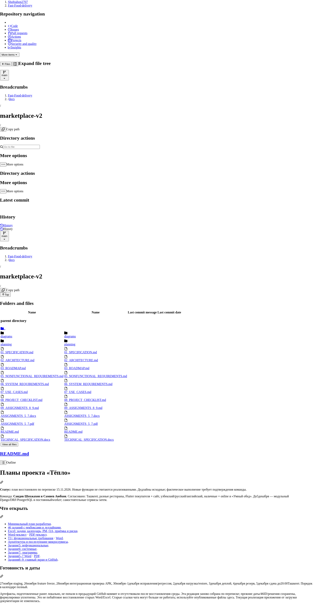

# Задания 8–9: программа и GitHub

Команда: Саидов Шохжахон, Самиев Аюбхон. Репозиторий: https://github.com/Shohjahon2707/Fast-Food-delivery .

## Задание 8. Программа и главный экран

В репозитории размещён Django-сервис одной кухни. Команда запуска — по корневому README. Ниже реальный скриншот главной веб-страницы, уже находившийся в репозитории. Это ранее сохранённое изображение, а не новая проверка текущего запуска или скриншот Android.

Android, многоресторанная модель и новые платежи здесь описаны как план. Для сдачи их реализации нужен отдельный снимок реально работающего клиента после разработки.

## Задание 9. Программные файлы в GitHub

Программный код находится в [репозитории студента](https://github.com/Shohjahon2707/Fast-Food-delivery), планы — в [docs/marketplace-v2](https://github.com/Shohjahon2707/Fast-Food-delivery/tree/main/docs/marketplace-v2). Загрузка документов подтверждена успешным push коммита [97195ed](https://github.com/Shohjahon2707/Fast-Food-delivery/commit/97195ed) в `main` и чтением опубликованной страницы.

Снимок ниже получен 15.11.2026 из Chromium с включённой проверкой HTTPS. Это публичная страница репозитория `Shohjahon2707`, а не авторизованный сеанс студента в браузере. Часть внешних ресурсов оформления была недоступна, поэтому страница отображается с неполными стилями; имена файлов и путь репозитория настоящие. Содержимое страницы не подменялось.

[Полный снимок страницы](evidence/github-page-full.png) · [URL, время и параметры снимка](evidence/github-files.json).
